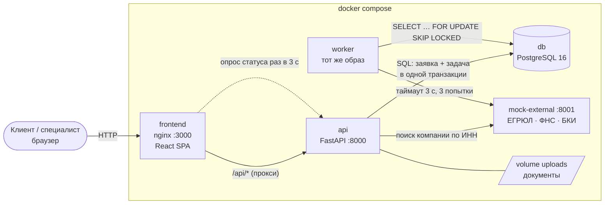

# Оборот — умный кредитный кабинет предпринимателя

Цифровой кредитный конвейер для малого бизнеса. Клиент выбирает продукт, подаёт заявку, видит статус
в реальном времени и получает результат. Специалист банка проверяет заявку и принимает решение.
**Одна база, одна заявка, два кабинета.**

Для кого: собственник, директор или бухгалтер небольшой компании без банковской экспертизы. Интерфейс
объясняет варианты, статус и следующий шаг простыми словами; каждый банковский термин — с подсказкой.

> Все данные синтетические. Внешние сервисы (ЕГРЮЛ, ФНС, БКИ), данные счёта в банке, подписание и выдача — симуляция.

## Возможности

**Клиент**
- **Витрина продукта** для гостей (`/welcome`): продукты, калькулятор платежа, как это работает, частые вопросы.
- **Кабинет в стиле интернет-банка:** меню разделов — главная, «Мои кредиты», «Получить финансирование».
  **Мобильная версия** (от 375 px): нижняя панель вкладок, как в банковских приложениях.
- **Предодобренный лимит** для компаний на обслуживании в банке: одно согласие — и за пару секунд «вам доступно до X ₽»
  по оборотам на счёте и кредитной истории, с объяснением и советами, как увеличить лимит.
- **Подбор продукта** за 3 вопроса: рекомендация с причиной, ставкой «от» и примерным платежом, альтернативы.
- **Анкета в 4 шага** с автозаполнением компании по ИНН, **выручкой из оборотов по счёту**, подсказками к каждому полю
  и автосохранением черновика.
- **Статус в реальном времени:** лента этапов со временем каждого шага и блок «Что дальше» — что происходит,
  сколько ждать, нужно ли что-то от клиента.
- **Решение:** одобрение, контрпредложение «вы просили / мы предлагаем», отказ с причинами и советом, «Подать заново».
- **Прозрачные условия:** график платежей, ПСК и основные условия до подписания; **пакет документов на подпись**
  (договор, график, поручительство руководителя или договор залога) — подпись одним кодом после «ознакомлен»;
  раздел **«Мои кредиты»** с ближайшим платежом и графиком.
- **Документы по запросу** (PDF/JPG/PNG), **переписка со специалистом**, уведомления в кабинете.

**Специалист банка**
- Очередь «Ждут меня» с классом риска и временем ожидания, фильтры.
- Карточка: данные клиента, проверки ЕГРЮЛ / ФНС / БКИ / **сверка выручки с оборотами по счёту**, скоринг по факторам
  («+15 / −20» с пояснениями), документы, переписка, история.
- Рекомендация системы и решение: одобрить, изменить условия с пересчётом платежа, запросить документы, отказать;
  комментарий обязателен; пересмотр решения, пока клиент не принял предложение.
- **Аналитика конвейера:** доля решений без специалиста, время до первого ответа и до решения (медианы), воронка
  «заявка → деньги», где сейчас заявки, классы риска, объём выдач.

Как это соотносится с рынком — [docs/competitors.md](docs/competitors.md).

## Быстрый старт

Нужны только **Docker** и **Docker Compose v2** (Docker Desktop или Docker Engine 24+), ~2 ГБ свободной памяти,
свободные порты 3000, 8000, 8001, 5433 (любой можно поменять в `.env`: `APP_PORT`, `API_PORT`, `MOCK_PORT`, `DB_PORT`)
и **интернет для первой сборки** (Docker скачивает образы и пакеты;
дальше стенд работает без сети — шрифты и все данные внутри).

```bash
git clone <адрес репозитория> oborot && cd oborot
cp .env.example .env        # необязательно: без .env используются те же значения по умолчанию
docker compose up --build
```

Первая сборка — 2–4 минуты. Когда в логах появится `worker: воркер запущен`, откройте:

| Что | Адрес |
|---|---|
| **Кабинет (точка входа)** | http://localhost:3000 |
| API и Swagger | http://localhost:8000/docs |
| Мок внешних сервисов | http://localhost:8001/docs |

Тестовые аккаунты (пароль у всех `demo12345`, на экране входа достаточно нажать на email):

| Email | Роль |
|---|---|
| `client1@demo.local` | клиент (Анна Иванова) |
| `client2@demo.local` | клиент (Тест Тестов) |
| `analyst@demo.local` | специалист банка |

Начать с чистой базы: `docker compose down -v && docker compose up --build`.

**Публичная ссылка на демо** (Cloudflare Quick Tunnel, без аккаунта):

```bash
docker compose --profile tunnel up -d tunnel
docker compose logs tunnel | grep trycloudflare.com
```

Нужен исходящий доступ к Cloudflare на порт 7844 (TCP/UDP). В сетях, где он закрыт (часть провайдеров и VPN-клиентов),
туннель не подключится — в логах будет `TLS handshake with edge error` или `Allow outbound TCP on port 7844`.
Запасной вариант без Docker и аккаунта — SSH-туннель localhost.run (ссылка вида `https://….lhr.life` появится в выводе):

```bash
ssh -R 80:localhost:3000 nokey@localhost.run
```

По ссылке демо доступно всем, у кого она есть, — с тестовыми аккаунтами. После показа туннель стоит закрыть.

## Архитектура



Как проходит заявка:

1. Клиент отправляет заявку. API в **одной транзакции** сохраняет её (`SUBMITTED`) и задачу в таблицу `jobs`
   и сразу отвечает. Повторная отправка с тем же `Idempotency-Key` ничего не дублирует.
2. Воркер забирает задачу (`FOR UPDATE SKIP LOCKED` — несколько воркеров не возьмут одну задачу),
   запрашивает ЕГРЮЛ, ФНС и БКИ (`CHECKING`), считает скоринг (`SCORING`) и принимает решение.
3. Фронт раз в 3 секунды спрашивает `GET /api/applications/{id}` и по полю `next_action` показывает,
   что происходит, сколько ждать и нужно ли действие клиента.
4. Если нужно решение человека — заявка попадает в очередь специалиста.

Статусы и переходы — [docs/state-machine.md](docs/state-machine.md), таблицы — [docs/data-model.md](docs/data-model.md).

## Компоненты

| Сервис | Что делает | Код |
|---|---|---|
| `frontend` | React-приложение (оба кабинета), nginx раздаёт сборку и проксирует `/api` | [frontend/](frontend/) |
| `api` | REST API, авторизация, state machine, кабинет специалиста. При старте применяет миграции и seed | [backend/app/](backend/app/) |
| `worker` | Кредитный конвейер: проверки → скоринг → решение. Переживает перезапуск | [backend/app/worker/](backend/app/worker/) |
| `mock-external` | Синтетические ЕГРЮЛ, ФНС, БКИ и данные счёта в банке (обороты из «АБС»); один ИНН намеренно «зависает» на БКИ | [mock-external/](mock-external/) |
| `db` | PostgreSQL 16: данные и очередь задач | — |

Ключевые места кода:

- **State machine** — [`backend/app/services/state_machine.py`](backend/app/services/state_machine.py): единственное место, где меняется статус.
- **Скоринг** — [`backend/app/services/scoring.py`](backend/app/services/scoring.py), веса и пороги — [`backend/scoring_config.yaml`](backend/scoring_config.yaml).
- **Кредитное решение** — [`backend/app/services/decision.py`](backend/app/services/decision.py): таблица «продукт × класс», причины и советы.
- **Воркер и очередь** — [`backend/app/worker/queue.py`](backend/app/worker/queue.py), [`pipeline.py`](backend/app/worker/pipeline.py).
- **Опрос статуса на фронте** — `useApplication` в [`frontend/src/api/queries.ts`](frontend/src/api/queries.ts).

### Стек

Python 3.12, FastAPI, SQLAlchemy 2, Alembic, Pydantic v2, PostgreSQL 16, uv, pytest ·
Vite, React 19, TypeScript, React Router, TanStack Query, react-hook-form + zod, Mantine, openapi-typescript ·
Docker Compose, nginx. Полный список и лицензии — [THIRD_PARTY_NOTICES.md](THIRD_PARTY_NOTICES.md).

## Скоринг и решение — коротко

Старт 40 баллов, затем каждый фактор добавляет или отнимает баллы, итог обрезается до 0–100:

| Фактор | Баллы |
|---|---|
| Возраст бизнеса | 6–12 мес: 0 · 1–3 года: +10 · > 3 лет: +15 |
| Сумма / годовая выручка | ≤ 20%: +15 · 20–50%: +5 · > 50%: −15 |
| Долговая нагрузка (все платежи / месячная выручка) | ≤ 15%: +15 · 15–30%: +5 · > 30%: −20 |
| Кредитная история | без просрочек: +15 · нет истории: 0 · просрочка ≤ 30 дн: −10 · 31–89 дн: −25 |
| Выручка год к году | рост: +5 · падение > 30%: −10 |
| Налоговый долг / массовый адрес | −15 / −5 |

**Стоп-факторы** (сразу отказ): ликвидация или банкротство, просрочка 90+ дней, бизнесу меньше 6 месяцев.
**Классы:** A ≥ 70, B 55–69, C 40–54, D < 40. Ставка = базовая ставка продукта + надбавка по классу
(A 0, B +2, C +4 п.п.). Платёж — аннуитетный: `P = S · i / (1 − (1 + i)^−n)`, `i` — годовая ставка / 12.
Каждый фактор с пояснением сохраняется в `scorings.factors` — специалист видит, почему получился такой балл.

## Как проверить

Пошаговые сценарии с точными цифрами — **[docs/scenarios.md](docs/scenarios.md)**. Коротко:

| № | ИНН | Что сделать | Что получится |
|---|---|---|---|
| 1 | `0010000017` | Экспресс 2 млн / 12 мес, выручка 30 млн (год назад 26 млн), платежи 50 тыс. | одобрение → подпись кодом → «Деньги зачислены» |
| 2 | `001000001006` | Экспресс 2 млн / 12 мес, выручка 11 млн (10 млн), платежи 50 тыс. | контрпредложение 1,4 млн |
| 3 | `0010000024` | Оборотный 10 млн / 24 мес, выручка 52 млн (54 млн), платежи 900 тыс. | запрос выписки → загрузка → специалист одобряет 7 млн |
| 4 | `0010000031` | любые параметры | отказ: компания ликвидируется |
| 5 | `0010000049` | Инвестиционный 20 млн / 48 мес + залог, выручка 120 млн (100 млн) | ручное рассмотрение → специалист одобряет |
| 6 | `0010000056` | Экспресс 1 млн | БКИ не отвечает → 3 попытки → специалист |
| 7 | — | `client1` открывает http://localhost:3000/applications/2 | «Нет доступа» (403) |

**Предодобренный лимит:** на главной `client1` — галочка согласия → «Рассчитать лимиты» → «Ромашка-Тест» до 13 750 000 ₽,
«Техно-Тест» и «Сфера-Тест» до 15 000 000 ₽, у «Вектора» и «Заката» нет счёта, по «Тишине» БКИ не отвечает.
«Оформить» из предложения ведёт в анкету с уже подставленной компанией и выручкой.

**Надёжность:** `docker compose stop worker` → отправить заявку (стоит в «Отправлена») →
`docker compose start worker` → заявка сама дообрабатывается.

### Автотесты

```bash
docker compose up -d db                 # тестам нужна база (порт 5433), БД oborot_test создаётся сама
cd backend && uv run pytest             # 131 тестов: скоринг, решения, переходы, 403, идемпотентность, сценарии 1–6
cd frontend && npm ci && npm run typecheck   # проверка типов фронтенда
cd frontend && npm run build            # проверка сборки
```

### Коллекция запросов

[docs/bruno/](docs/bruno/) — коллекция для [Bruno](https://www.usebruno.com/) (бесплатный open-source клиент API):
`Open Collection` → папка `docs/bruno` → окружение `local`. Схема API — [docs/openapi.json](docs/openapi.json).

## Переменные окружения

Все переменные имеют значения по умолчанию в `docker-compose.yml`, поэтому `.env` необязателен.

| Переменная | По умолчанию | Что задаёт |
|---|---|---|
| `APP_PORT` / `API_PORT` / `MOCK_PORT` / `DB_PORT` | `3000` / `8000` / `8001` / `5433` | порты на компьютере; API, мок и база открыты только для `localhost` |
| `POSTGRES_USER` / `POSTGRES_PASSWORD` / `POSTGRES_DB` | `oborot` | доступ к базе |
| `JWT_SECRET` | dev-значение | секрет подписи токена входа (для реальной среды — длинный случайный) |
| `DEMO_MODE` | `true` | подсказка с тестовыми аккаунтами на экране входа |
| `DEMO_PASSWORD` | `demo12345` | пароль тестовых аккаунтов (задаётся при первом запуске) |
| `STAGE_DELAY_SECONDS` | `2` | пауза между этапами конвейера, чтобы на демо было видно движение статуса |
| `WORKER_POLL_SECONDS` | `1` | как часто воркер проверяет очередь |
| `JOB_LEASE_SECONDS` | `30` | через сколько секунд задачу упавшего воркера подхватит другой (аренда продлевается на каждом этапе) |
| `EXTERNAL_TIMEOUT_SECONDS` | `3` | таймаут одного запроса к внешнему сервису |
| `EXTERNAL_RETRIES` | `3` | сколько попыток до ухода заявки к специалисту |
| `EXTERNAL_RETRY_PAUSE_SECONDS` | `1` | пауза между попытками |
| `MOCK_DELAY_SECONDS` | `0.3` | искусственная задержка ответа мок-сервиса |

## Допущения

- **Синтетика вместо интеграций.** ЕГРЮЛ, ФНС и БКИ — наш мок по HTTP с тем же контрактом, что был бы у
  адаптера к реальному сервису. Подключение настоящих источников — замена `MOCK_EXTERNAL_URL` и адаптера
  в `backend/app/services/external.py`.
- **Данные «своего» банка — тоже мок.** Обороты по расчётному счёту за 24 месяца лежат в `mock-external` (`/abs/accounts/{inn}`);
  в реальности это автоматизированная банковская система. Компании «Вектор-Тест» и «Закат-Тест» счёта в банке не имеют.
- **Предодобренный лимит** — та же скоринговая модель: максимальная сумма, при которой заявка была бы одобрена
  автоматически. Это предварительная оценка, а не обязательство банка.
- **Скоринг на правилах, а не ML.** Нет данных для обучения, а каждое решение нужно объяснять клиенту и
  специалисту. Веса — в конфиге, версия модели сохраняется вместе с оценкой.
- **Цифры условные:** лимиты продуктов, ставки (24 / 20 / 18%), надбавки, пороги — для демонстрации.
- **Подписание — симуляция:** код показывается на экране, SMS и электронной подписи нет. Выдача — смена статуса.
- **Уведомления — только в кабинете** (колокольчик), без email и SMS.
- **Обновление статуса — опросом раз в 3 с,** а не WebSocket: проще, надёжнее за прокси, для заявки достаточно.
- **Компания привязывается к пользователю** при первой заявке по её ИНН; права подписи не проверяются.
- **HTTP без TLS** — локальный стенд. Cookie входа `httpOnly` и `SameSite=Lax`.

## Что сознательно не сделано

- LLM/ИИ-помощник: по условию — только открытые модели через Ollama в отдельном профиле; в MVP не включён,
  система полностью работает без него.
- Реальные интеграции, электронная подпись, платёжный контур, антифрод.
- Регистрация пользователей, восстановление пароля, несколько сотрудников одной компании.
- Нативное мобильное приложение — по условию только веб. Сам веб адаптирован под телефоны: от 375 px нижняя панель
  вкладок вместо бокового меню, «Что дальше» первым блоком, очередь специалиста карточками, окна на весь экран.
- Отдельный брокер очередей (Redis/RabbitMQ) — для объёмов MVP хватает таблицы в PostgreSQL.
- Аудит действий специалиста сверх истории статусов, роли руководителя и согласование лимитов.

## Документация

| Документ | О чём |
|---|---|
| [docs/development.md](docs/development.md) | **для разработчиков:** правила, устройство проекта, команды |
| [docs/scenarios.md](docs/scenarios.md) | тестовые сценарии шаг за шагом |
| [docs/competitors.md](docs/competitors.md) | похожие продукты банков и что мы взяли |
| [docs/state-machine.md](docs/state-machine.md) | статусы, переходы, таблица решений |
| [docs/data-model.md](docs/data-model.md) | модель данных |
| [docs/product.md](docs/product.md) | проблема, гипотезы JTBD, user story map, MoSCoW |
| [docs/interview-guide.md](docs/interview-guide.md) | сценарий интервью с предпринимателем |
| [docs/demo-script.md](docs/demo-script.md) | сценарий демо на 5–7 минут |
| [docs/jury-qa.md](docs/jury-qa.md) | вероятные вопросы жюри и ответы |
| [docs/openapi.json](docs/openapi.json), [docs/bruno/](docs/bruno/) | схема API и коллекция запросов |
| [THIRD_PARTY_NOTICES.md](THIRD_PARTY_NOTICES.md) | сторонние компоненты, лицензии, смоделированные интеграции |
