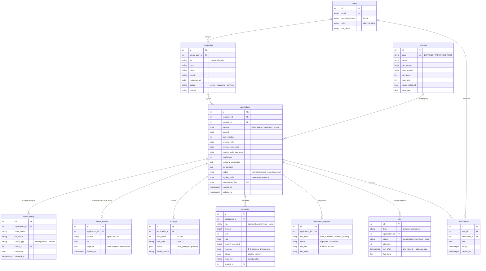

# Модель данных

Одна база PostgreSQL на оба кабинета. Таблицы описаны в
[`backend/app/models.py`](../backend/app/models.py), миграции — в `backend/migrations/versions/`
(применяются автоматически при старте `api`).

Соглашения: деньги — целые рубли (`BIGINT`), ставки — проценты годовых, все перечисления хранятся строками,
время — с часовым поясом.



## Что добавлено к исходной схеме и зачем

| Поле | Зачем |
|---|---|
| `products.description` | короткое описание продукта для экрана подбора |
| `applications.bki_consent` | галочка согласия на запрос кредитной истории (без неё заявку не отправить) |
| `applications.signing_code` | код подписания — симуляция, показывается клиенту на экране |
| `decisions.advice` | советы клиенту хранятся отдельно от причин решения |
| `document_requests.file_name` | исходное имя файла, чтобы специалист видел, что открывает |
| `created_at` в нескольких таблицах | время этапов на ленте и сортировка очереди |

## Очередь задач

`jobs` — это и есть очередь, отдельный брокер не нужен. Воркер берёт задачу так:

```sql
SELECT ... FROM jobs
WHERE (status = 'pending' OR status = 'running') AND run_after <= now()
ORDER BY id LIMIT 1
FOR UPDATE SKIP LOCKED;
```

Взяв задачу, воркер ставит `status = 'running'` и `run_after = now() + 60 с` («аренда»).
Если он упал, через 60 секунд задачу подхватит следующий запуск. Заявка и её задача создаются
в одной транзакции при отправке — потерять задачу нельзя.
