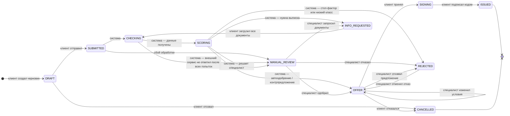

# Статусы заявки (state machine)

Статус заявки меняется **только** функцией `transition()` в
[`backend/app/services/state_machine.py`](../backend/app/services/state_machine.py). Она:

1. проверяет, что переход есть в таблице разрешённых (иначе HTTP 409);
2. проверяет, что его делает тот, кому можно — клиент, специалист или система (иначе HTTP 403);
3. пишет запись в `status_history` (из неё строится лента этапов и аудит);
4. создаёт уведомление в кабинете клиента (а при `MANUAL_REVIEW` — и специалистам).

Решения специалиста без комментария не принимаются.

## Кто что может

| Переход | Кто |
|---|---|
| DRAFT → SUBMITTED, DRAFT → CANCELLED | клиент |
| SUBMITTED → CHECKING → SCORING → (OFFER / MANUAL_REVIEW / INFO_REQUESTED / REJECTED); SUBMITTED / CHECKING → MANUAL_REVIEW при сбое | система (воркер) |
| MANUAL_REVIEW → OFFER / INFO_REQUESTED / REJECTED | специалист |
| OFFER → OFFER / REJECTED, REJECTED → OFFER | специалист (пока клиент не принял предложение) |
| INFO_REQUESTED → CHECKING | клиент (загрузка последнего документа) |
| OFFER → SIGNING / CANCELLED, SIGNING → ISSUED | клиент |

## Правила, которые не видны на схеме

- **Без бесконечного цикла запросов.** Если по заявке уже запрашивали документы, после повторной проверки
  она всегда идёт к специалисту (`MANUAL_REVIEW`), даже если по таблице решений снова получился бы запрос.
- **Технический сбой — к человеку.** Если ЕГРЮЛ, ФНС или БКИ не ответили за 3 попытки по 3 секунды, заявка
  не «зависает», а уходит к специалисту с комментарием, какой сервис недоступен.
- **«Подать заново»** после отказа создаёт новый черновик с копией анкеты; старая заявка остаётся в истории.
- **Клиент принимает только те условия, которые видел.** Вместе с «Принять» уходит номер версии предложения
  (`decision_id`); если специалист успел изменить условия — 409, и на экране появляются новые.
- **Внутренний комментарий специалиста к отказу клиент не видит:** ему показывается отдельная «причина для клиента».
- **Воркер падает на задаче целиком** (процесс убит, а не ошибка) — после лимита попыток заявка уходит специалисту,
  задача не крутится вечно.

## Таблица кредитных решений (после скоринга)

| Класс риска | EXPRESS | WORKING | INVEST |
|---|---|---|---|
| A (≥ 70) | автоодобрение | автоодобрение | к специалисту |
| B (55–69) | контрпредложение: сумма × 0,7 | к специалисту | к специалисту |
| C (40–54) | отказ | запрос выписки → к специалисту | к специалисту |
| D (< 40) | отказ | отказ | отказ |

Таблица, веса и пороги — в [`backend/scoring_config.yaml`](../backend/scoring_config.yaml).
